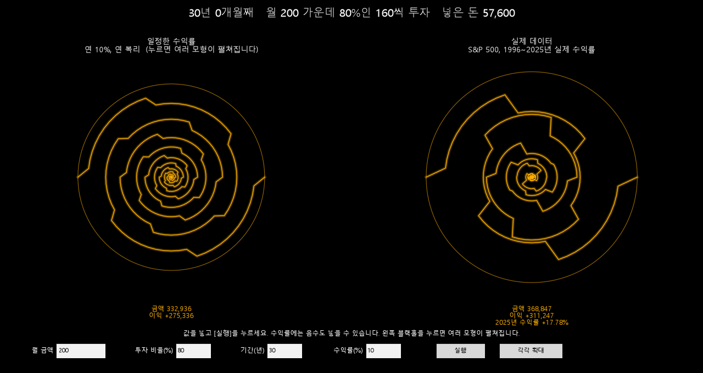
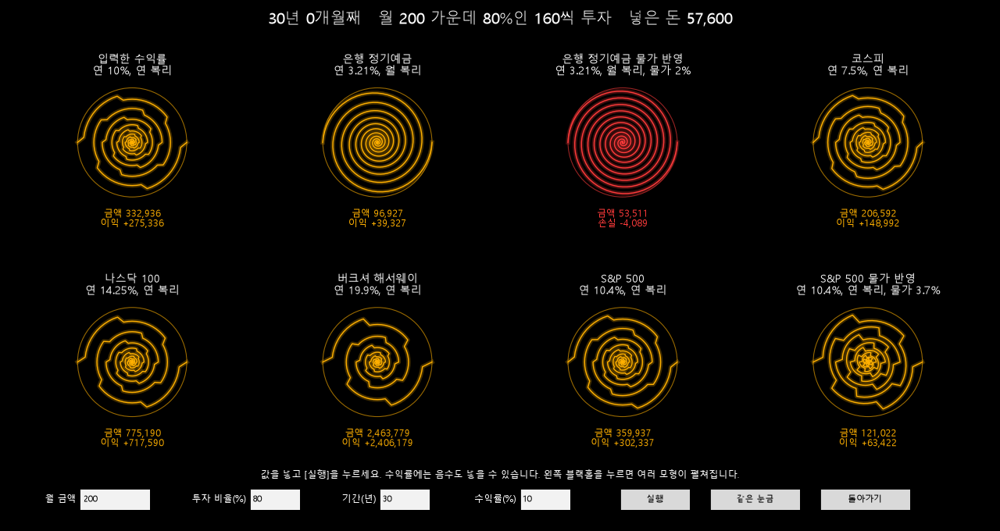

# BlackholeModel

달마다 넣는 돈이 복리로 얼마나 변하는지를, 시간이 지날수록 커지는 블랙홀의 나선으로 보여 주는 파이썬 프로그램입니다.



## 무엇을 보여 주나

- 블랙홀은 팔이 두 개인 나선입니다. 5년에 한 바퀴 돌면서 바깥으로 자랍니다.
- 나선의 중심에서 끝까지의 거리는 **넣은 돈에서 변한 양**입니다.
- 이익이면 주황, 손실이면 빨강으로 그립니다.
- 모든 블랙홀을 같은 눈금으로 그려서 크기를 바로 견줄 수 있습니다.

첫 화면에는 블랙홀이 두 개 나옵니다.

| 왼쪽: 일정한 수익률 | 오른쪽: 실제 데이터 |
|---|---|
| 입력한 수익률을 해마다 똑같이 적용합니다. | S&P 500의 실제 연도별 수익률을 차례대로 적용합니다. |
| 나선이 고르게 커집니다. | 수익률이 떨어진 해마다 나선이 안쪽으로 꺾입니다. |

왼쪽 블랙홀을 누르면 수익률, 복리 주기, 물가 반영 여부가 서로 다른 모형들이 펼쳐집니다.



## 실행

Python 3.12에서 만들었습니다.

```
pip install -r requirements.txt
python blackhole.py
```

창이 열리면 아래 칸에 값을 넣고 **[실행]** 을 누릅니다.

| 입력 | 뜻 | 처음 값 |
|---|---|---|
| 월 금액 | 한 달에 쓸 수 있는 돈 | 200 |
| 투자 비율(%) | 그 가운데 투자하는 비율 | 80 |
| 기간(년) | 1년부터 60년까지 | 30 |
| 수익률(%) | 왼쪽 블랙홀에 쓰는 연 수익률. 음수도 됩니다. | 10 |

| 버튼 | 하는 일 |
|---|---|
| 실행 | 입력한 값으로 처음부터 다시 그립니다. |
| 각각 확대 | 블랙홀마다 제 크기에 맞춰 키워서 나선의 모양을 봅니다. 다시 누르면 같은 눈금으로 돌아갑니다. |
| 돌아가기 | 펼친 화면에서 첫 화면으로 돌아갑니다. |

터미널에는 해마다의 금액과, 바로 전 해보다 늘어난 양이 표로 출력됩니다.

글꼴은 Windows의 맑은 고딕을 씁니다. 다른 운영체제에서는 `blackhole.py` 위쪽의 `font.family`를 한글 글꼴로 바꿔야 글자가 보입니다.

## 계산 방식

달마다 다음을 되풀이합니다.

1. 이번 달 돈을 금액에 더한다.
2. 금액에 이율을 곱해 이자를 계산한다.
3. 복리 주기가 끝나면 그동안 쌓인 이자를 금액에 합친다.
4. 합쳐진 금액이 다음 달 계산에 다시 들어간다.

| 함수 | 모형 |
|---|---|
| `yearly_compound` | 연 복리. 1년에 한 번 이자를 합칩니다. |
| `monthly_compound` | 월 복리. 달마다 이자를 합칩니다. |
| `reflect_inflation` | 물가 반영. 계산한 금액을 물가가 오른 만큼 나눕니다. |
| `actual_compound` | 실제 데이터. 해마다 그 해의 실제 수익률로 계산합니다. |

## 모형과 자료

| 모형 | 연 수익률 | 복리 주기 | 물가 | 근거 |
|---|---|---|---|---|
| 은행 정기예금 | 3.21% | 월 | | 한국은행, 2026년 8월 저축성수신금리 |
| 은행 정기예금 물가 반영 | 3.21% | 월 | 2% | 한국은행 물가안정목표 |
| 코스피 | 7.5% | 연 | | 2005년부터 20년, 배당 포함 추정 |
| 나스닥 100 | 14.25% | 연 | | 1985~2024년 |
| 버크셔 해서웨이 | 19.9% | 연 | | 1965~2024년, 주주 서한 |
| S&P 500 | 10.4% | 연 | | 1957~2025년, 배당 재투자 |
| S&P 500 물가 반영 | 10.4% | 연 | 3.7% | |
| 실제 데이터 | 해마다 다름 | 연 | | S&P 500 연도별 수익률 1966~2025년, 배당 포함 |

실제 데이터 모형은 가장 최근 N년을 씁니다. 기간을 30년으로 넣으면 1996~2025년입니다.

출처
- [S&P 500 연도별 수익률, 뉴욕대 스턴 경영대학원 다모다란 교수 자료](https://pages.stern.nyu.edu/~adamodar/New_Home_Page/datafile/histretSP.html)
- [S&P 500 장기 평균](https://www.sofi.com/learn/content/average-stock-market-return/)
- [버크셔 해서웨이 60년 수익률](https://www.cnbc.com/2025/05/05/warren-buffetts-return-tally-after-60-years-5502284percent.html)
- [나스닥 100](https://www.nasdaq.com/articles/nasdaq-100-indexr-celebrates-40-years-innovation)
- [코스피 장기 수익률](https://valueflake.com/%EC%BD%94%EC%8A%A4%ED%94%BC-vs-sp500-%EC%9E%A5%EA%B8%B0-%EC%88%98%EC%9D%B5%EB%A5%A0/)
- [한국은행 금융기관 가중평균금리](https://www.bok.or.kr/portal/bbs/B0000501/view.do?nttId=10096706&oldMenuNo=201150&menuNo=201264&programType=newsData&depth=201264&relate=Y)
- [한국은행 물가안정목표제](https://www.bok.or.kr/portal/main/contents.do?menuNo=200291)

## 프로그램에서 확인되는 것

월 160씩 30년을 넣는 조건(넣은 돈 57,600)에서 나온 값입니다.

- **복리는 음수 수익률에서도 같은 식으로 작동합니다.** 수익률 -10%면 30년째에 17,390이 남습니다.
- **금액은 0 아래로 내려가지 않습니다.** 그래서 손실은 넣은 돈을 넘지 못합니다.
- **같은 비율로 떨어져도 돈이 많이 쌓인 뒤일수록 잃는 금액이 큽니다.** 실제 데이터에서 2008년(-36.55%)에는 11,159가 줄었고, 2022년(-18.04%)에는 40,736이 줄었습니다.
- **평균 수익률이 비슷해도 과정은 다릅니다.** 실제 데이터에서는 13년을 넣은 2008년 말에 금액(23,584)이 넣은 돈(24,960)보다 적었습니다.

## 한계

- 코스피 7.5%는 개인 블로그의 추정치입니다. 기간을 다르게 잡은 자료에서는 4%대로 나옵니다.
- 미국 물가 3.7%는 S&P 500의 물가 반영 수익률 6.5%에서 거꾸로 계산한 값입니다.
- 은행 정기예금을 월 복리로 둔 것은 가정입니다. 실제로는 단리 상품이 많습니다.
- 물가를 반영한 금액을 물가를 반영하지 않은 넣은 돈과 견줍니다. 그래서 물가 반영 모형의 손실이 실제보다 크게 나옵니다.
- 세금, 수수료, 환율은 계산하지 않습니다.
- 실제 데이터 모형은 항상 2025년에 끝나는 구간만 씁니다.
